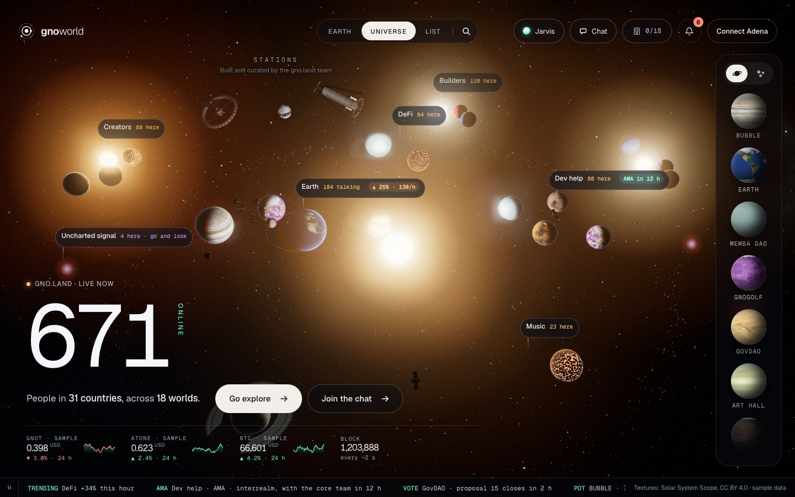

# gnoworld



gnoworld is a place to meet on gno.land. Every project is a world you can fly to, every
world has its rooms to talk in, and Jarvis, an assistant, explains what a realm does and
prepares the calls you sign yourself in Adena. The picture above is the approved prototype;
the real app is being rebuilt from it, slice by slice.

## What is here

| Folder | What it holds |
|---|---|
| `packages/core` | The rules, pure TypeScript shared by everything else (today: the IRC line parser) |
| `r/` | The realms, in gno |
| `tools/` | A Go reference client for the seal realm |
| `scripts/` | The gate and the harness that keeps the code honest |
| `docs/`, `adr/` | How it is designed, built and reviewed |

The web app (`app/`), the server and the demo stack arrive in the next merges of slice 1.

## Install

You need macOS or Linux, git, Python 3, Go 1.26, and:

1. **Node 24.22.0**, the version in `.node-version`. With nvm: `nvm install 24.22.0`. The
   gate finds it through nvm even when your shell uses another Node.
2. **pnpm.** Any recent pnpm works: it switches itself to the exact version the project
   names (12.14.0).
3. **A gno toolchain** that matches the chain, for the realms: see
   [docs/DEVELOPMENT.md](docs/DEVELOPMENT.md), "Toolchain".
4. **gitleaks**, for the full gate: `brew install gitleaks`.

Then, in the repository:

```sh
pnpm install          # also turns on the git hooks
./scripts/check.sh    # the gate, in under a minute
```

`pnpm install` refuses any package published less than a day ago, and runs no install
script a dependency brings unless it is listed in `pnpm-workspace.yaml`. If it stops on one
of those, that is the protection working, not a bug.

## Everyday commands

| Command | What it does |
|---|---|
| `./scripts/check.sh` | The fast gate: formatting, types, lint, tests, dead code, copies, CSS and comment rules, the realms, the hooks. It runs before every commit and at the end of every Claude Code turn |
| `./scripts/check.sh --full` | Everything above, plus the harness's own probe, coverage (85% everywhere, 100% in `core`), the coverage of the lines you changed, mutation testing and a scan of the whole history for secrets. It runs before a merge |
| `pnpm run test` | The unit tests |
| `pnpm run coverage` | The tests with coverage, under `coverage/` |
| `pnpm run mutate` | Mutation testing, with its report in `reports/mutation/index.html` |

## How work happens here

Work goes one slice at a time, each with a plan approved before any code
([docs/plans/](docs/plans/)). Tests come first. Code written with Claude Code passes the
same gate as anyone's, then a review sized by risk ([docs/REVIEW.md](docs/REVIEW.md)). The
whole method is in [docs/DEVELOPMENT.md](docs/DEVELOPMENT.md), "The harness".

## Read more

- The design: [ADR-0001](adr/0001-gnoworld.md), and the approved prototype's scope,
  [ADR-0002](adr/0002-validated-prototype.md)
- How the code is laid out: [docs/ARCHITECTURE.md](docs/ARCHITECTURE.md)
- How it looks: [docs/DESIGN-SYSTEM.md](docs/DESIGN-SYSTEM.md)
- What comes next: [docs/plans/backlog.md](docs/plans/backlog.md)

Planet textures in the prototype: [Solar System Scope](https://www.solarsystemscope.com/textures/), CC BY 4.0.
