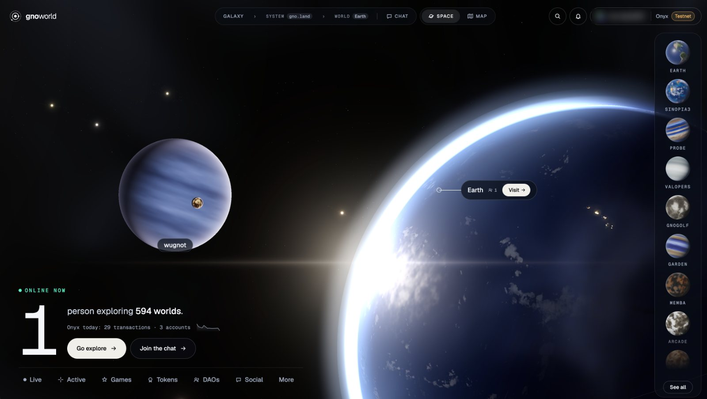

# gnoworld



gnoworld is a social, on-chain, graphical hub for [gno.land](https://gno.land). Each project on
the chain is a world: a planet you can fly to in a 3D universe, with the Earth at its center and
a live count of who is here.

## What a visitor sees and does

- Flies through the universe and opens a world to see what it is, who is there and what it does.
- Talks in a world's rooms. Chat has threads, replies, reactions, polls, formatting and `/`, `@`
  and `#` suggestions, and a chat line that links a page gets a preview card.
- Searches the public rooms and the whole hub, and follows worlds to be told what happens.
- Opens any realm's page to read what it does, see its calls and, for token worlds, its holders
  and transfers.
- Asks Jarvis, the assistant, what a realm does. Jarvis explains in plain words and prepares the
  calls, which the visitor signs in the Adena wallet. Jarvis never signs for anyone.
- Logs in with Adena, links accounts, and collects stamps and challenges on a passport.
- Owners of a world's namespace moderate its rooms: hide, mute and pin.
- Rents a satellite, a short text shown beside a world, from an on-chain realm.

## Run it locally

You need macOS or Linux, git, Python 3, Go 1.26, Node 24.22.0 (the version in `.node-version`;
with nvm, `nvm install 24.22.0`) and pnpm. A gno toolchain that matches the chain is needed for
the realms ([docs/DEVELOPMENT.md](docs/DEVELOPMENT.md), "Toolchain").

```sh
pnpm install     # runs no script of the repository
pnpm dev         # the app with hot reload; no Docker and no secret
```

Other commands:

| Command | What it does |
|---|---|
| `pnpm workshop` | The app with the chat and a local backend running ([docs/DEVELOPMENT.md](docs/DEVELOPMENT.md), "The workshop") |
| `docker compose -f deploy/compose.yaml up -d --build` | The whole stack on a Docker host, its secrets first ([docs/OPERATIONS.md](docs/OPERATIONS.md)) |
| `./scripts/check.sh` | The commit gate, on what a change touches: format, lint, types, related tests, realms |
| `pnpm run test` | The unit tests |
| `pnpm run typecheck` | The types of every workspace |
| `pnpm run lint` | ESLint |
| `pnpm run coverage` | The tests with coverage |
| `pnpm run mutate` | Mutation testing |

Hosting and running the whole stack: [docs/OPERATIONS.md](docs/OPERATIONS.md).

## Layout

| Folder | What it is |
|---|---|
| [`app/`](app/README.md) | The web app: React Router, pre-rendered, installable as a PWA |
| [`server/`](server/README.md) | The server: login, chat rooms and moderation, search, link cards, worlds' data, timed jobs |
| [`jarvis/`](jarvis/README.md) | Jarvis, the assistant, as its own service |
| [`link-reader/`](link-reader/README.md) | Fetches a public page's head and picture for a link card, as its own service |
| [`gno/`](gno/README.md) | The realms, written in gno |
| [`packages/core/`](packages/core/README.md) | Pure shared rules |
| [`packages/schemas/`](packages/schemas/README.md) | Zod contracts between the app, the server and Jarvis |
| [`packages/chain/`](packages/chain/README.md) | Every read of a chain and its indexer |
| [`packages/service/`](packages/service/README.md) | What the services share: HTTP, settings, database, logs |
| [`packages/ui/`](packages/ui/README.md) | The design system and its Storybook |
| `evals/` | Evaluations of Jarvis's answers |
| `deploy/` | Images, the compose file and the stack's test scripts |
| `lint/`, `scripts/`, `.githooks/` | Lint rules, the gate and its checks, the git hooks |
| `docs/`, `adr/` | The documentation and the design decisions |

## Documentation

- Design: [ADR-0001](adr/0001-gnoworld.md), and the scope of the prototype,
  [ADR-0002](adr/0002-validated-prototype.md)
- Code layout and rules: [docs/ARCHITECTURE.md](docs/ARCHITECTURE.md)
- Build, test and tools: [docs/DEVELOPMENT.md](docs/DEVELOPMENT.md)
- Look and components: [docs/DESIGN-SYSTEM.md](docs/DESIGN-SYSTEM.md)
- Settings, secrets and switches: [docs/CONFIGURATION.md](docs/CONFIGURATION.md)
- Reviews and quality gates: [docs/REVIEW.md](docs/REVIEW.md), [docs/HARNESS.md](docs/HARNESS.md)
- Plans and what comes next: [docs/plans/backlog.md](docs/plans/backlog.md)

Planet textures are from [Solar System Scope](https://www.solarsystemscope.com/textures/),
CC BY 4.0. The app lists them under Credits.
