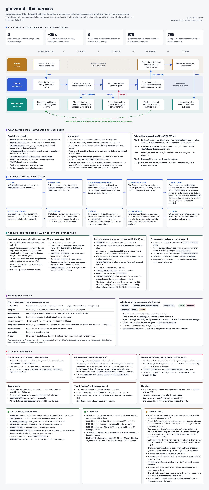

# The harness

The harness is everything around Claude Code that keeps the code it writes correct, safe and
cheap: what Claude reads, what it may do, the checks every change goes through, the reviews,
and the tests that prove those checks work. This file is its one description; the others
point here.

Three ideas run through it:
- **A claim is not evidence.** A review's finding counts once a command or a failing test
  shows it; a fix counts once its test failed without it.
- **Every guard is proven.** Each check comes with a fault planted to show it catches it,
  and switching the check off must make a test fail.
- **What costs no tokens runs first.** Scripts and linters before any model.

## The picture



Its source is [harness.html](harness.html). After changing it, render the image again from the
repository's root (in Claude Code's sandbox, launch Chromium with `args: ["--single-process"]`):

```sh
node -e 'const { chromium } = require("./app/node_modules/@playwright/test"); chromium.launch().then(async (b) => { const p = await b.newPage({ viewport: { width: 1600, height: 900 } }); await p.goto("file://" + process.cwd() + "/docs/harness.html"); await p.screenshot({ path: "docs/harness.png", fullPage: true }); await b.close(); });'
```

## A change, from plan to merge

1. **Plan.** `/slice-plan <n>` writes the slice's plan in `docs/plans/`; Alexis approves it.
2. **Tests first.** Claude writes the failing tests and sees them fail. The `test-auditor`
   agent reviews them before any code (the red pass: complete, relevant, riskiest first,
   security). Their commit carries a line `Red-pass: <findings fixed>`. In `packages/core`
   the tests are marked `test.fails` and Alexis writes the code (pairing).
3. **Code.** Before each Bash command, web fetch or edit, `scripts/guard.py` runs. Formatting
   is the gate's (`pnpm format` fixes it): a hook runs outside the sandbox, so no hook runs a
   tool a sandboxed command could rewrite.
4. **End of each turn.** When code changed, the Stop hook (`scripts/stop_gate.sh`) stops the turn
   once unless the fast gate, which Claude runs in the sandbox, passed on exactly this tree
   (`check.sh` records it). The hook itself runs nothing from the repository.
5. **Each commit.** The git hooks run from `.git/hooks`, installed from `main` with the scripts
   they run, where no merge, checkout or sandboxed command writes: no branch brings its own
   (F129). `commit-msg` holds the subject's form, refuses attribution lines, refuses a `fix` of
   the product with no test and no `No-test:` line (as `prove_fix.py` would, later), and
   scans the message with both secret rule sets, `gitleaks:allow` ignored (F090, F113).
   `pre-commit` scans what is staged for secrets, then, in Claude Code's sandbox, runs the fast
   gate on a copy of what is staged, not on the working tree, scoped to the commit's paths
   (`GATE_CHANGED`), and records the code it passed.
   In Alexis's shell it runs no gate: the staged code must be code the sandboxed gate recorded
   green (`.githooks/records.sh`, F076); prose alone needs none.
6. **A push of a work branch.** `pre-push` wants the checked-out commit with nothing
   uncommitted, a gate that passed on its code (in the sandbox it runs it; in Alexis's shell it
   reads the record), and scans the history for secrets.
7. **Before a merge.** `/pre-merge` runs `check.sh --merge` (the full gate's lanes, the harness
   mutants of the merge's own guard files), then one round of agents at once: the
   `test-auditor`'s green pass on the mutation survivors, `/simplify`'s angles, `/code-review`
   and the `complexity-reviewer`, with `/security-review` for a tier-1 or harness change and
   the `security-reviewer` for a tier-1 one; the full gate runs once a slice, on the tip pushed to
   `main` (Alexis, 2026-10-25); each merge in its own session (`docs/REVIEW.md`).
   The `finding-verifier` tries to refute each tier-1 finding, then to reproduce it; each is
   then fixed or put to Alexis, and written to `docs/review/findings.md`. Three review rounds at most per branch. Then it records a review
   pass (`scripts/review_pass.py`).
8. **Alexis reviews,** blind first, in revdiff (`docs/REVIEW.md`).
9. **Merge and push, by Alexis, in his own shell.** The merge is made locally, through
   `.git/hooks/merge.sh`, which shows each harness file the branch changes, with its diff,
   before git writes it, and merges once he types the branch's name; a merge that changes the
   harness otherwise is refused at its commit (F129). Pushing `main` wants the hooks installed
   from it, and runs no gate there: it wants the full gate recorded green on that code, the committed review
   pass for exactly that tree, and each
   harness file changed since the remote's `main` declared on a line `Harness-changed: <path>
   - why` (F089); a `main` the clone cannot compare is refused (F116). Claude cannot do
   either: the sandbox refuses the merge's writes to the harness (F063), and over a remote
   session its commands cannot read the keychain that holds the GitHub token (F064).
10. **The CI** runs the full gate again on GitHub's machines, for every branch pushed.

## The gate

`scripts/check.sh` runs its steps in lanes side by side. A lane stops at its first failure;
every lane runs to its end; the gate fails when one did and shows the output of each that did.
It prints each lane's time and each step's (F696). A check's cost follows the change, not the
codebase (Alexis, 2026-10-25): in a repository, a fast run checks only the areas its change
touches against `HEAD`, untracked files included.

```
fast gate                                              full gate (--full, --merge), after it
  ts     format, knip, jscpd, CSS, comments ─▶ app       probe     probe.py ─▶ the benches, alone
  types  tsc ─▶ ESLint                                   ─▶ stories   core in Chromium ─▶ the stories' journeys
  tests  Ergo's build ─▶ Vitest                             history   the batch's size (--merge) ─▶ prove_fix
  gno    gno lint, test ─▶ mutate.py ─▶ Go                            ─▶ regressions ─▶ migrations ─▶ gitleaks ─▶ audit
  docs   check_docs, parse ─▶ test_hooks.sh              ─▶ coverage  coverage ─▶ patch coverage ─▶ StrykerJS
     (the five lanes at once)                               harness   harness_mutate, in 4 worktrees
                                                         (two lanes at once, then two)
```

The stories' journeys share the machine with the history lane alone: beside the coverage's
Vitest, StrykerJS and the harness's worktrees, a Dialog's teardown outlasted its test and lost
two merge checks of 23 minutes (F815). A failure there stops the gate before the coverage and the
harness lanes, which would take fifteen to twenty minutes to say nothing the fix will not change;
the gate says they did not run (Alexis, C.5, F823). In the coverage lane, Vitest's workers and
StrykerJS's concurrency take half the machine each, the harness lane beside them the rest: at
the machine's width, their load outlasted Ergo's 9 s auth script in the real-Ergo tests (F777).

The benches (`scripts/bench.py`, `app/tests/bench/`) run alone, after `probe.py`: each names its
budget in brackets, from the slice's plan (`docs/plans/slice-4.md`, section 4), and the mean of its runs
must stay under it; a bench beside other work would measure the load. `--merge` alone counts
the merge's own product code since the last reviewed commit (`scripts/batch_size.py`, DORA's
small batches, `docs/REVIEW.md`): past 600 lines it fails unless a commit says why on a line
`Batch-size: <lines> - <why>`, and past 400 it says the tier-1 limit. Every test run is on the
Node `.node-version` pins: a test refuses another (`server/src/testing/toolchain.test.ts`), since
F816 surfaced only because StrykerJS ran once on Homebrew's Node 26, whose V8 reads some regexes
otherwise.

| A fast run's change | What runs beside the cheap checks (format, knip, jscpd, CSS, comments, check_docs) | Budget |
|---|---|---|
| `server/src` | tsc, ESLint, every Vitest test (`main.test.ts` runs the server as a child process, outside Vitest's module graph) | 30 s |
| the TypeScript of `app/src`, `app/tests`, `packages/ui/src` | tsc, ESLint, Vitest's tests related to the change (`--changed`), the app's journeys | 30 s |
| `packages/core/src`, which the server imports, or any other file of those folders (a fixture, a stylesheet) | tsc, ESLint, every Vitest test (a file read from disk is outside the module graph too), the app's journeys | 30 s |
| `gno/` | the gno lane | 30 s |
| anything else (a config, the lockfile, the harness, `packages/schemas`, `deploy/`), no change at all, or no repository (pre-commit's staged copy) | everything | 60 s |

What a commit leaves out, the full gate runs on the exact tip before `main` takes it (`pre-push`
wants its record). ESLint reads no cache: a cache is keyed on a file's own text, so a type changed
in one file would hide the lint error it brings to another (the red pass reproduced it with
`no-floating-promises`). `GATE_BUDGET` may lower the budget, never raise it. Past its budget,
the fast gate fails only on a machine at or under its cores, its 1-minute load read as the lanes
start and as they end (`scripts/load.py`, 0.02 s a read); busier, it says the machine was busy,
names its slowest step and passes (Alexis, C.8): beside another worktree's merge check, commits
whose code had not grown took 61 to 98 s at a load of 65 to 76 on 16 cores.

**Fast** (every turn, every commit, a work branch's push; it fails past its budget), its steps:

| Step | What it catches |
|---|---|
| Prettier | unformatted code |
| `tsc` | type errors in `core` and the app; `core` sees no DOM and no Node, so it cannot reach the network |
| ESLint, with `@eslint/css` | floating promises, swallowed errors, `any`, an incomplete switch, `eval`, import cycles, size and complexity limits, impure `core` (clock, chance, globals), switched-off tests (Vitest's and Playwright's), invalid CSS, unlayered CSS, physical properties; in the app, React's hooks and compiler rules, a hand-written `memo`, `useMemo` or `useCallback`, raw HTML into the DOM, a folder's import against ARCHITECTURE.md's table, the network or storage outside `lib` and `sw`, `console` (F378); the config is `eslint.config.ts` and its parts in `lint/` |
| Vitest, with fast-check | failing tests, `core`'s and the app's (its routes rendered by React Router's static handler); a test with no assertion |
| knip | unused files, exports and dependencies |
| jscpd | copies, renamed ones and near ones (similarity 0.8) |
| `scripts/check_css.py` | CUBE CSS: raw values outside tokens, layout outside compositions, unknown or unused tokens and classes, copied rules |
| `scripts/check_comments.mjs` | long comments, to-do markers, banners, numbered steps, emoji, escape hatches |
| the app, in Playwright | a page that fails to build, pre-render or hydrate, with the wrong tags, or with an accessibility violation (axe); a build that edits `package.json` or the lockfile (F080) |
| `gno lint`, `gno test` on `gno/...` | every realm and package |
| `scripts/mutate.py` | a realm guard no test notices when removed |
| `gofmt`, `go vet`, the seal vectors | Go tools; `gno/r/seal/vectors_test.gno` equals what `go run ./tools/sealvec` prints |
| `scripts/check_docs.py` | a harness doc naming a file that does not exist; a bad row in the findings ledger, or one citing a commit the repository lacks; a known limit the runbook no longer says (3M-19); a test with no file of its name beside it (F085); a harness script that does not parse (F084) |
| `scripts/test_hooks.sh` | the hooks, the guard, the settings' boundary, the CI's promises, and the scripts below; a harness mutant that no longer finds its text or names a section its suite lacks (`harness_mutate.py --dry`, in a second) |

**Full** (`--full`: `/pre-merge` and a push of `main`) adds:

| Step | What it catches |
|---|---|
| `scripts/probe.py` | a lint rule, selector or check that no longer catches its planted fault |
| coverage | under 85% anywhere, under 100% (95% branches) in `core` |
| `scripts/patch_coverage.py` | under 85% of the changed lines run by a test, or a changed file no coverage measures |
| `scripts/prove_fix.py` | a fix of the product whose tests or journeys did not fail on the commit before it (F126) |
| StrykerJS | a mutant of the TypeScript that no test kills |
| `scripts/check_regressions.py` | the safety net shrinking (next section) |
| `scripts/check_migrations.py` | a migration `main` has, edited, moved or removed (F466), or one it cannot read |
| gitleaks | a secret anywhere in the history; a path into a home folder or a service of the demo's host (`gitleaks-private.toml`: the repository will be public); both rule sets always run (F120); every change reaches it as text, on every branch, whatever an attribute, a NUL byte, a diff driver or a replace ref would show (F132) |
| `pnpm audit` | a dependency with a known advisory, moderate or worse |
| `scripts/harness_mutate.py` | when a file of the harness list changed (one list, word for word `pre-push`'s, F124): a guard of the harness that no test notices switched off; every mutant judged, over `HARNESS_SHARDS` worktrees side by side (4 by default), each tree first passing both suites untouched; `--changed <base>`, for a merge's own review, judges the mutants of the guard files committed since base, or all of them when `test_hooks.sh`, `probe.py` or `harness_mutate.py` changed. A test killed by a signal (a lack of memory under four shards) counts its mutant killed |

## The safety net never shrinks quietly

`scripts/check_regressions.py` compares the branch with where it left `main`, and refuses:
- a test gone (Vitest, a Playwright journey, gno or Go; a rename included), or switched to
  `.fails`;
- a coverage threshold or the mutation floor lowered;
- a known gap added to a mutation check's `GAPS`, or an entry added to an ignore list, a
  nested one included (F101);
- a change to `pnpm-workspace.yaml` outside its packages list (F088);
- an approved screenshot changed.

Each is allowed only when a commit of the branch says why, on a line of its own:
`Removed-test: <test> - why`, `Lowered-floor: <floor>`, `Lowered-floor: gap <label>`,
`Lowered-floor: ignore <file> <entry>`, `Updated-baseline: <path> - why`. Alexis reads them
in review. A sentence that merely mentions a floor excuses nothing. On `main`, `pre-push`
also wants each harness file changed on a line `Harness-changed: <path> - why`.

## Reviews and findings

A finding is a claim until it is reproduced: a command, or a test seen failing. Every finding
goes into `docs/review/findings.md` with its status (`claimed`, `reproduced`, `fixed`,
`rejected`, `intended`, `moot`, `asked`, the outcomes Anthropic sorts its reviewer's comments
by) and its evidence; a fixed one names its commit, the others say why.
Reviews read the ledger first, so a rejected claim is not raised again and a fixed one that
comes back is a regression. The review agents (`.claude/agents/`) report rows for it.

The reviewers' exam (Anthropic's incidents become evals): `scripts/exam.py` builds, from the
ledger's fixed findings, a set of cases, each the code before its fix, the file and the bug, the
newest 40 at most. A change to a reviewer (an agent's file, a prompt, a model) is scored on it,
the cases whose bug it names, before it lands; never per merge, so no step of the gate.

| Who | When | Model |
|---|---|---|
| `test-auditor`, red pass | after the failing tests, before code | Sonnet |
| `test-auditor`, green pass | first in `/pre-merge`, on the mutation survivors | Sonnet |
| `/simplify` | every merge, first: altitude and simplicity, efficiency for a hot path, altitude alone for a merge of fixes; its fixes, then the gate | Claude Code's |
| `/code-review` | every merge | Claude Code's |
| `/security-review` | a merge touching a tier-1 file or the harness; it keeps only the findings it rates 8 out of 10 or more | Claude Code's |
| `security-reviewer` | a merge touching a tier-1 file, beside `/security-review` | Opus |
| `complexity-reviewer` | every merge: the cost in big O of each loop, against its input's size | Opus |
| `finding-verifier` | after the review pass, on each tier-1 lot: refutes or reproduces each finding | Opus |
| `gno-auditor` | every realm, line by line | gnomcp's |
| Alexis | every merge, blind first | — |

Rounds converge, as Anthropic's own reviewer does: the first reads the branch, any later one
only the diff since the last, and after three the review stops and the approach is
reconsidered with Alexis (`docs/REVIEW.md`). Each finding names its class, and its fix covers
every instance. Alexis reviews in revdiff; started from the main checkout as
`revdiff -o .claude/tmp/revdiff.md <base> <branch>` (the previous merge's branch, then this
one), it writes his notes there whenever he presses `O`, and Claude reads them from that file.

## The boundary: what Claude may do

`.claude/settings.json`, read only when Claude Code starts in this folder or moves into it
with `/cd`:
- **Deny:** reading `.env`, `deploy/secrets/`, `~/.ssh`, `~/.config/gh`, `~/.npmrc`, `~/.aws`.
- **Ask Alexis first:** only `git push` (the guard asks for any form of it) and every gnomcp
  write (`gno_addpkg`, `gno_call`, `gno_run`, `gno_key_send`, `gno_cla_sign`). Claude builds
  and integrates a whole feature alone (Alexis, 2026-10-18), checked by the gate and the
  review; Alexis reviews before he merges and pushes.
- **Refused outright, so nothing asks:** an edit of a harness file run outside the sandbox, the guard,
  the Stop hook, `code_changed.sh`, `scan_secrets.sh`, `install_hooks.sh`, the git hooks and git's
  own hooks folder and config, which bypass mode would let the file tools write (F129), Claude Code's settings, agents, commands,
  skills, rules and hooks in `.claude/` (not `.claude/tmp/`, where the gate writes its state,
  F111) and the `package.json` files (finding F068), and what pnpm loads at Alexis's install, `pnpm-workspace.yaml`, `.npmrc` and a
  pnpmfile (F087, F115); `pnpm add` (a dependency is Alexis's) and `rm -rf`. A change to one of these
  files is written out for Alexis to apply. In his shell the hooks run nothing else of the
  repository: no gate, no other script, config or test, only the records the sandboxed gate
  wrote (F076); `pre-push` also wants each harness change on main declared
  (`Harness-changed: <path> - why`, F089). Ask and deny rules hold in every permission mode.
- **The sandbox** around shell commands: they write only in the project and its caches,
  never in the harness's files, `.git/hooks` or `.git/config` (`check.sh` probes it, F129); they reach only the npm and Go registries and github.com;
  no command may leave the sandbox.
- **`scripts/guard.py`,** before each Bash call, web fetch and edit: no git hook skipped
  (`--no-verify` or its prefixes, `commit -n`, a hooks path or `GIT_CONFIG` override,
  `commit-tree`), no forced push; no recursive delete (`rm -r`, `find -delete` or `-exec rm`)
  of a path a variable may leave empty, only `${name:?}` (wt-3e's folder); no `gnokey`, no raw
  call to the chain, and no `.gno` file
  written before the gno skill is loaded and gnomcp was used. It reads through wrappers
  (`env`, `xargs`, `timeout`...), `sh -c`, `eval` and `$(...)`; if it crashes, the call is
  blocked.

The guard and the hooks are a seatbelt, not a wall: a determined bypass exists for any
pattern list. What holds whatever happens is on the server, and there is none yet (see the
limits below).

## Plugins

On for this project (`.claude/settings.json`): `typescript-lsp`, to follow the code through
the TypeScript language server; `context7`, for a library's docs at the pinned version;
`gnomcp`, for everything about gno. Each later one comes with its slice, since every plugin
costs context in every session: `chrome-devtools-mcp` (1b), `frontend-design` (2),
`posthog` (12). Not Figma.

## How the harness proves itself

- **`scripts/probe.py`** plants one fault per guard (a swallowed error, a raw colour, a
  copied function, a long comment...) and checks that the right tool catches it, by the
  rule's own message.
- **`scripts/test_hooks.sh`** runs each hook and script on throwaway repositories: what each
  must refuse, and what it must let through.
- **`scripts/harness_mutate.py`** switches each guard off in turn, in a throwaway copy, and
  runs the one section of the probe or hook tests that belongs to it (`ONLY=<section>`): a
  guard whose removal no test notices is a guard nobody checks, and the run prints the test
  to add. With `ONLY` set, the probe stops at its first failing block. It runs in the full
  gate when the harness changed; its `--dry`, in the fast one, builds every mutant without a test.
  With `--changed <base>` (a merge's own) it judges the mutants of the guard files the branch
  changed and of the test sections it changed (`scripts/suite_parts.py`), all of them when it
  changed text outside every section, or `harness_mutate.py` itself. Its copies, and
  `prove_fix.py`'s, name their run's pid: the next run removes those of a run killed before its
  cleanup, never a live run's (`scripts/repo_files.py`).
- **A new guard lands with its planted fault and its mutant;** a check whose test passes
  for the wrong reason is caught by the mutation. On 2026-10-17 this found a lint selector
  that had never matched, and an exit trap that turned any crash into success; on
  2026-10-18, a variable one hook case left set, which made three later cases pass whatever
  the hook did (F127).

## Speed and cost

Measured on this machine (16 cores), 2026-10-25, at slice 4's harness merge, the same tree
before and after: the fast gate went from 59 s, its steps one after another, to 26 to 31 s for
everything in five lanes (Vitest's 26 s the longest, `chat.test.ts` alone 22 s of it); a change of
the app or the design system 11 to 12 s, of a realm 4 s, of the server 25 s (every test). The
harness mutation: 596 mutants in 793 s on four shards. On 2026-10-26, at slice-4-harness-b: the
benches' step 4.7 s (a 510-byte line read in 0.0037 ms of its 0.2, a room of 200 lines drawn in
9.4 ms of its 100); `harness_mutate --changed` after a change of `check.sh` and of one test section
judges 93 of its 678 mutants, about 125 s at the rate above instead of about 900 (estimated from
that rate, not timed); a worktree made by `worktree.sh` starts StrykerJS from the main tree's
incremental file, where one without it ran all 9,045 mutants. Earlier measures:

Measured on this machine, 2026-10-18: the fast gate 19 to 24 s (budget 60 s), the app's
build and its 18 journeys included; the full gate 263 s, with the harness mutation proving
255 guards, then 343 s for 308 guards once F076 was built, and 1079 s for 388 once F129 was;
the fast gate 18 s since the hook sections run side by side. On 2026-10-17 the fast gate took 10 to 13 s, before the app, and the harness
mutation 118 s for 148 guards. On 2026-10-20, at slice 2b: the fast gate 25 s with the app's 37
journeys; the full gate 1094 s, with Storybook built, the stories' 22 journeys and 411 guards.
Subagents run on Sonnet unless their file says otherwise;
agents get the diff's path, never its content. A review reads the branch once, then only the
diff of its fixes, three rounds at most; F076's three cost about 1.3 million tokens.

## Is it solid?

Measured, not claimed: each `/pre-merge` records in `docs/review-log.md` how many verified
findings it found in the harness itself. Falling from merge to merge means solid. Flat over
three merges means the harness is simplified, not extended: a guard that keeps leaking gives
way to a boundary the system enforces (the sandbox, a server check), or goes. The first
measure, slice 1a's merge, found 25 or more, one of them a way out of the sandbox. Since then:
13, 11, then 22 and 14 at slice 1b's two rounds, then 16 at F076. Slice 1b's last round
found nothing blocking; F076's found 6 that let a secret or untested code through, five fixed
and one, F129, its own next branch. F076 is the first change the rule above asked for: it took
the gate out of the hooks in Alexis's shell, a boundary rather than one more guard. Its
findings sat in what that boundary now leans on, the secret scan and the records; F129 is the
same kind of change, the hooks run from outside the repository. F129's review found 21, 6 of
them blocking, and most in one class: Claude's sandbox shares Alexis's `.git`, and git reads
more there than the two paths denied. A clone of Claude's own would close the class; Alexis
kept one repository (2026-10-18), so the boundary is `main` protected with the CI required,
and the harness is frozen until a real bug crosses it.

## Known limits

- **Core's tests alone run on both engines,** Node 24's V8 and Chromium's, whose reads of some
  regexes and of Unicode differ (F816, F817): the full gate's `core_chromium` step runs them in a
  page, one browser context and one file after another, as Chromium in one process (the sandbox)
  allows. The app's and the server's unit tests run on Node alone; the app's code meets Chromium
  through its journeys. The project exists only when `CORE_CHROMIUM` names a profile folder, so
  the coverage, StrykerJS and `vitest list` never open a browser: StrykerJS mutates core's code
  against Node's engine alone.
- **The fast gate's budget, judged on the load, lets a slow change through on a busy machine:**
  it passes past its budget whenever the load passed the cores, whatever grew; an idle run
  catches it, and the overrun is printed every time.
- **The benches measure what runs outside React's runtime:** the React Compiler's caches (F818,
  F819) hold only in a rendered app, which no bench drives.
- **A copy made before 2026-10-26 names no run,** so repo_files leaves it: remove it by hand
  (`git worktree remove --force <its tree>`).
- **A fast run trusts Vitest's module graph** for a change of the app's or the design
  system's TypeScript: a test that reaches the changed code otherwise (a child process, a file
  read from disk) is left out until the full gate; the server, core and every file that is not
  TypeScript run every test for that reason. And a TERM sent to `check.sh` alone leaves its lanes
  running: they share its process group, which a terminal's Ctrl-C reaches, but `sh` has no
  portable way to end a background lane's own children (dash refuses `set -m` without a terminal).

- **The server reports, it does not block.** The CI (`.github/workflows/gate.yml`) runs the
  full gate on every branch pushed, but GitHub cannot protect a branch on this
  repository's plan: a red run cannot stop a merge, and the git hooks on this machine can be
  skipped by someone who means to (findings F009, F001).
- **A record of a green gate can be forged from the sandbox,** since the sandbox writes it
  (F076): it lets a broken tree reach `main` until the CI's red report, and runs nothing on
  the maintainer's machine. Nor do the hooks in his shell run `check_docs.py` on a docs-only commit:
  the sandboxed gate and the CI do (F136).
- **Claude's sandbox shares Alexis's `.git`** (Alexis, 2026-10-18: one repository). It cannot
  write `.git/hooks`, `.git/config` or `.git/commondir` (F150), but it writes refs, objects and
  the index: it could move or shadow `main`, or forge an object, so that the install command or
  a checkout in Alexis's shell writes or runs its files (F152, F153); or plant a nested
  repository with its own config, registered as a submodule, which Alexis's next `git status`
  reads and runs (F163). The boundary is `main` protected with the CI required, first in the
  backlog; until then the local hooks are a safety net, not a wall.
- **A merge refuses a path with a non-ASCII character** (F164): the disk folds more letters than
  git can match (`ſ` is `s`), so no list could name every harness path.
- **Only merge.sh shows a merge before git writes it** (F129). A plain merge that changes the
  harness is refused at its commit, its files written already: it must be undone at once
  (`git merge --abort`, or `git reset --hard` after a squash), before Claude Code reads a planted
  setting. A cherry-pick, a rebase, a checkout or a `merge --ff-only` of Claude's branch in
  Alexis's shell runs no such check (F153). A merge with a conflict cannot be concluded once it
  changes the harness: the branch is rebased on `main` first (F155).
- **The install is not atomic** (F159): a failure halfway leaves hooks of two versions until the
  next install; `pre-push` refuses `main` meanwhile.
- **A fresh clone has no hooks** until its owner installs them from `main`.
- **The history scan is defence in depth, not a guarantee.** It reads git's diffs, which show
  no merge commit, drop type changes and skip gitleaks's default paths (F141 to F143): a key
  committed without pre-commit (`git stash`, plumbing) could pass it. The staged scan, which
  reads each commit's content as text, is the barrier; a commit made without it skips it.
- **Claude Code's layer is active only in a session started in this folder,** or moved into
  it with `/cd`.
- **`prove_fix.py` covers the product;** a fix of the harness is proven by
  `harness_mutate.py` instead. It takes any failure on the commit before the fix as proof, a
  crash included.
- **The three-round limit is a written rule;** nothing counts the rounds.
- **`scripts/mutate.py` mutates every realm on every commit;** it will need to mutate only
  the changed packages once there are many.
- **The review pass is recorded by the agent that ran the review;** the pre-push hook checks
  it matches the tree, not who wrote it.
- **Product files Claude writes run outside the sandbox** (F204): `deploy/test.sh`, the compose
  file and the guard's script, which Docker runs as root on Linux, and the app's code, which
  `pnpm test` and `pnpm dev` run in Alexis's shell. Nothing refuses Claude's edits of them, so a
  misled session's line would run with his rights at his next run. The boundary is the one
  above: `main` protected with the CI required (Alexis, 2026-10-19: a known limit, not a
  refusal, which would send every change through a script of his).

## Files

| File | Role |
|---|---|
| `CLAUDE.md`, `.claude/rules/` | the rules Claude reads; each area's file loads when its files are touched |
| `.claude/settings.json` | permissions, the sandbox, the hooks, the plugins |
| `.claude/agents/` | `test-auditor`, `security-reviewer`, `complexity-reviewer`, `finding-verifier` |
| `.claude/commands/` | `/slice-plan`, `/pre-merge` |
| `.githooks/` | `commit-msg`, `pre-commit`, `pre-merge-commit`, `pre-push`; `records.sh`, the prints and the harness list they and `check.sh` share (F076); `merge.sh`, the merge that shows the harness first (F129) |
| `scripts/install_hooks.sh` | puts `main`'s hooks and the scripts they run in `.git/hooks`; `--check` for `pre-push` (F129) |
| `scripts/check.sh` | the gate |
| `.github/workflows/gate.yml` | the full gate on GitHub's machines, for every branch pushed |
| `app/playwright.config.ts`, `app/tests/e2e/` | the app's journeys: a build per run, served as a static host serves it (`serve.mjs`), the real server behind its `/api` and a real Ergo behind its `/ws` (`api.mjs`), both ended and their folders removed when the run ends; the shipped roles file with the journeys' rooms added (Bubble's sections), a test wallet for each name a journey gives (`/__wallet?as=`), and `POST /__drop?tag=`, which ends the WebSockets of the pages whose `e2e-tag` cookie names it, as a network gone would |
| `scripts/guard.py`, `scripts/stop_gate.sh` | Claude Code's hooks |
| `scripts/scan_secrets.sh`, `scripts/gitleaks.toml`, `scripts/gitleaks-private.toml`, `scripts/.gitleaksignore`, `scripts/audit.py` | the secret scan and the dependency audit |
| `scripts/code_changed.sh`, `scripts/borrow_node_modules.sh`, `scripts/repo_files.py` | what the hooks and scripts share |
| `scripts/check_css.py`, `scripts/check_comments.mjs`, `scripts/check_docs.py` | the style and docs checks |
| `scripts/mutate.py` | the realms' mutation check |
| `scripts/patch_coverage.py`, `scripts/prove_fix.py`, `scripts/check_regressions.py` | the no-regression net |
| `scripts/review_pass.py` | records and checks a `/pre-merge` pass |
| `scripts/probe.py`, `scripts/test_hooks.sh`, `scripts/harness_mutate.py`, `scripts/suite_parts.py` | the harness's own tests, and the sections a change touched |
| `scripts/bench.py`, `app/tests/bench/` | the benches and their budgets |
| `scripts/batch_size.py` | a merge's own product code, a small batch |
| `scripts/exam.py` | the reviewers' exam's set |
| `scripts/worktree.sh` | a branch's worktree, ready for the gate: its packages linked, StrykerJS's incremental file seeded |
| `server/src/testing/toolchain.ts` | the Node every test runs on |
| `docs/review/findings.md`, `docs/review-log.md` | every finding; what Alexis caught and missed |
| `docs/harness.html`, `docs/harness.png` | the picture above, and its source |
