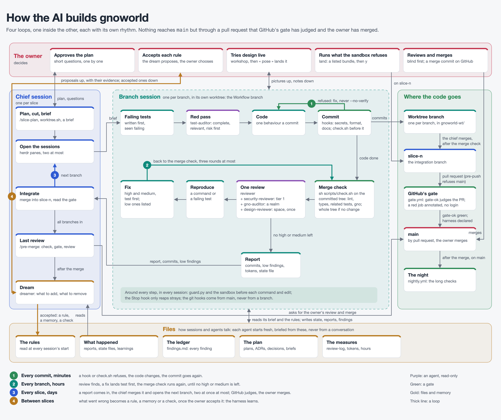

# The harness

The harness is everything around Claude Code that keeps the code it writes correct, safe and
cheap: what Claude reads, what it may do, the checks every change goes through, the reviews,
and the tests that prove those checks work. This file says what runs today; why each piece is
there lives in `docs/decisions.md`, the findings ledger and the review log, by its id.

Three ideas run through it:
- **A claim is not evidence.** A review's finding counts once a command or a failing test
  shows it; a fix counts once its test failed without it.
- **Every guard is proven.** Each check comes with a fault planted to show it catches it,
  and switching the check off must make a test fail.
- **What costs no tokens runs first.** Scripts and linters before any model.

## The picture



It shows four loops, one inside the other: a commit through the hooks and the commit gate, a branch through review and fixes, a slice through the chief's
integration and GitHub's gate, and the dream back into the rules. Its source is
[harness.html](harness.html). After changing it, render the image again from the
repository's root (in Claude Code's sandbox, launch Chromium with `args: ["--single-process"]`):

```sh
node -e 'const { chromium } = require("./app/node_modules/@playwright/test"); chromium.launch({ args: ["--single-process"] }).then(async (b) => { const p = await b.newPage({ viewport: { width: 1600, height: 900 }, deviceScaleFactor: 2 }); await p.goto("file://" + process.cwd() + "/docs/harness.html"); await p.screenshot({ path: "docs/harness.png", fullPage: true }); await b.close(); });'
```

## Who does what

- **The owner** approves each slice's plan, reviews blind first, runs what the
  sandbox refuses (the push, through `land`; the merge into `main` on GitHub), and accepts or
  refuses each rule the dream proposes.
- **The chief session**, one per slice, plans it (`/slice-plan`), makes the slice's shared folder
  (`.claude/tmp/slice-<n>/` with `reports/`), cuts it into branches, sizes each before it starts, gives each branch its own range of finding numbers
  (so two branches side by side never take the same ones), makes its worktree and brief, opens its session in a herdr pane through one
  script that alone leaves the sandbox (`~/.claude/skills/herdr-branch/scripts/open.sh`), merges each finished branch into
  the slice's integration branch, reads GitHub's gate, runs the slice's last `/pre-merge`, with the `design-reviewer` once more over every 3D view, then the dream.
  The worktrees live beside the main checkout, in `~/Server/gnoworld-wt/`, which no branch session's sandbox writes: the
  chief's session starts with that folder added (`claude --add-dir ~/Server/gnoworld-wt` in the main checkout, or the owner
  types `/add-dir ~/Server/gnoworld-wt` once in it), for its worktrees and its merges there; never in a settings file,
  which every branch session would read too. Its sandbox writes no folder outside its checkout, the temp folder and the caches, so
  it needs the folder added from the first move.
- **A branch session**, one per branch, two at most at once, works in its own worktree, made by
  `scripts/worktree.sh` and never by hand (one store of packages, a real `.bin`), in
  `~/Server/gnoworld-wt/`, where no session's shell writes but its own folder (its file tools still can), the one root where the script makes or removes a folder
  (`worktree.sh remove`); it writes no other session's worktree, by any tool. Its
  pipeline is the Workflow `branch` (`.claude/workflows/branch.js`): the failing tests, the red
  pass, the code, the merge check, one combined review, the high and medium fixes, the merge check
  again; it returns its commits, the low findings for the owner, the lines that loosen the net and its tokens.
  An agent that gives no report blocks it; the harness's and the realms' files bring their reviews
  whatever its arguments say, and so does every tier-1 path of `docs/REVIEW.md`'s table that exists (the relay's auth script,
  the CSP, `deploy/`, `core/markdown`, `lib/adena`, the login of the server and of the client, the server's roles, the worker): the
  table writes each path in backticks, and `scripts/check_docs.py`, which pre-commit runs on every commit, prose alone included, fails
  when the table names one its `TIER1` lacks, or `TIER1` holds one the table does not name. Its argument `base` (`main` when absent) is the branch the
  work is cut from: the merge check's file list, the reviewer's diff and `since` read from it. The merge check runs
  `sh scripts/check.sh` on the committed tree, which takes no option (D13168).
  `test_hooks.sh`'s section `workflow_branch` runs it under stubbed globals.
- **Agents** are fresh, briefed from files (never forks), four at most at once, each asked for a
  short report saved to a file. The sessions coordinate through files: the plan,
  `docs/decisions.md`, the ledger, a state file per branch and one shared learnings file.
- **The dream** (`/dream <slice>`, `.claude/commands/dream.md`), at each slice's end, keeps a
  dated copy of the memory, then the `dreamer` agent (read only, no shell) reads the agents' reports, the learnings,
  the review log, the ledger and the handoff (never transcripts) and proposes rule, memory, test
  and check changes, each with its evidence, prevalence and cost, standing on committed rows, and as
  many removals: a rule, a test or a check whose cost what it caught does not repay. The owner
  accepts each, reading a memory's full text first; a rule or a check goes on a branch, to `main` through a pull request.

## A change, from plan to merge

1. **Plan.** `/slice-plan <n>` writes the slice's plan in `docs/plans/`; the owner approves it.
2. **Tests first.** The failing tests, seen failing; the `test-auditor`'s red pass, once per
   branch, never on a fixer's tests; the commit that brings the tests and their code carries
   `Red-pass: <findings fixed>`.
3. **Code.** Before each Bash command, web fetch or edit, `scripts/guard.py` runs.
4. **End of each turn.** The Stop hook (`scripts/stop_gate.sh`) only reaps (D13173): it stops what runs of this project left behind, which the sandbox cannot see, a node process naming a folder `gnoworld/`
   whose parent is gone for 30 minutes (2 hours while a gate runs), or a test tool's 3 hours old or more but a dev or watch mode, each
   logged to `~/Library/Logs/gnoworld-reaped.log`, where the sandbox cannot write; it runs nothing from the repository and never
   blocks a turn. A run killed on the way may leave a node process behind; `pgrep -fl gnoworld/` lists them.
5. **Each commit.** The git hooks run from `.git/hooks`, installed from `main` with the scripts
   they run, where no merge, checkout or sandboxed command writes: no branch brings its own. `commit-msg` holds the subject's form, refuses attribution lines, scans the message for secrets, and, in Claude Code's sandbox only,
   refuses a hidden character in it with the staged `scripts/hidden.py` (D36). `pre-commit` scans what is staged for secrets, prose
   included, with the scan installed beside it. In Claude Code's sandbox, told by `SANDBOX_RUNTIME` or, that unset, by the hook failing to
   open itself for writing, which the sandbox forbids, it first refuses a harness file (`.githooks/records.sh`'s list, and a path with a
   non-ASCII character: D241), then wants each staged file as it is on disk, and runs Prettier on them and `scripts/check_docs.py`
   (D13173): seconds. It runs no gate: `sh scripts/check.sh` is what a session runs before committing code, and GitHub's gate judges each
   pull request. In the owner's shell it runs the scan alone, nothing of the working tree. So a harness change reaches GitHub as a git
   bundle the owner approves with `land` (D13213), installed once in `~/.local/bin` by main's `install_hooks.sh`: the session drops the
   bundle of one branch and the pull request's text in `/private/tmp/claude-<uid>/land/`; `land`, in the owner's Terminal, copies them,
   checks the bundle holds that branch, never main, from GitHub's main, runs that main's own secret scan over the range and its
   commit-msg on each message (what pre-push and commit-msg held for his own push), gitleaks over the text, refuses a character the
   Terminal would not show as itself, lists the subjects, each
   harness file with its lines added and removed, the declaration lines, any workflow file, how the branch on GitHub changes and 16 hex
   of the tip, and on his y pushes that tip with his gh login and opens the pull request (`scripts/land.py`, which reuses
   `scripts/agent_pr.py`'s reading and scans). What a session writes: a branch named `[a-z0-9][a-z0-9-]{0,62}`, never
   main, holding GitHub's main as it is now (merged in if main moved), each harness file it touches declared on a `Harness-changed:` line
   (`scripts/ci_changes.sh` run on the range first); in the drop folder, nothing but `<branch>.bundle` (`git bundle create` of
   `<main>..<branch>`, one head, 512 MiB at most) and `<branch>.md` (UTF-8, 64 KiB at most: the title on its first line, 256 characters
   at most and no control character, a blank line, the body); and the tip's 16 hex, given to the owner. He types `land`, compares the 16
   hex in its listing, answers `y`; the two files are removed once the pull request is opened or found, so the folder holds one branch
   at a time. The change exists only on GitHub until he merges it. `pre-merge-commit` gives a merge commit the same checks, and a merge always makes one
   (the install's `merge.ff false`). pre-commit reaches `git commit` and `git merge` alone: cherry-pick, revert, rebase, am and git's
   plumbing (`stash create` then `update-ref`, as `commit-tree`) commit with no hook, which guard.py refuses when typed, not when a
   script file runs them; such a commit meets its wall on GitHub, whose changes job refuses a harness file no commit declares on a line
   `Harness-changed: <path> - why` and a path this disk may read as another, and in the owner's reading of the pull request.
6. **A push.** `pre-push` refuses `main`, which takes pull requests alone (D13165), its deletion included, and scans the whole history
   for secrets before anything leaves.
7. **Before a merge.** `/pre-merge` (`docs/REVIEW.md`): `check.sh` on the committed tree, GitHub's gate, one combined review
   by the `reviewer` agent (with the `security-reviewer` for a tier-1 file or the harness, the
   `gno-auditor` for a realm), each finding reproduced, high and medium fixed,
   low ones listed for the owner.
8. **The owner reviews,** blind first, and merges on GitHub. `deploy/test.sh` is the gate's deploy-stack job on a change to `deploy/` or to what the services' images build from (D13180, D13203: `server/`, `jarvis/`, `link-reader/`, `packages/service|chain|schemas/`, `app/data/`, the root manifests); F13163's fix ended D13191's hand run (D13400). Run by hand, to debug or for `--mutants`, it runs from a copy of the commit the owner reviewed
   whose commit and files hash to its name (`docs/OPERATIONS.md`, "Run test.sh from the commit you reviewed"), never from a worktree. It takes a lock per Docker project
   (a folder in `~/.cache/gnoworld-tools` holding its pid): a second run, from another terminal or session, is
   refused while a first holds it; a project a Ctrl+C left up (`gnoworld-demo-mutant-<pid>`) is named with the
   command that removes it. `test_hooks.sh`'s section `deploy_lock` runs it against stubbed Docker.
9. **Merge, by the owner, on GitHub.** A pull request whose `gate-ok` reads green, merged with "Create a merge commit" (D13164,
   D13165): `main` takes no push. Claude can neither: the push asks, and the ruleset refuses `main` any push.
10. **The CI** on GitHub judges every pull request to main, every push to main and a run by hand: one job reads what the
    change calls for with the base commit's own detector, the checks run side by side, and `gate-ok`, the one check main
    will require, reads every result with the base commit's verdict; `nightly.yml` runs the long checks at night.

## The gate

Two gates (D13168): `scripts/check.sh`, which a session runs before committing code, on what the change
touches, in seconds (pre-commit itself runs the secret scan, Prettier and check_docs alone, D13173); GitHub's,
`.github/workflows/gate.yml`, on each pull request, by what the change calls for, its one verdict `gate-ok`. The night, `nightly.yml`, runs what both leave out.

**The commit gate** (`sh scripts/check.sh`, which takes no option and takes seconds when no test runs, a minute or two when the tests or the whole tree run;
it runs in a repository alone, its change git's). Four lanes side by side: a lane stops at its first failure, every lane runs to its end, and the gate fails when one did,
shows its output and ends on `check.sh: FAILED at <lane>:<step>`; a pass ends on `all checks passed in N s`.

| Lane | Steps | For a change of |
|---|---|---|
| lint | the harness's floor (`check_docs.py`, every `scripts/*.py` parsing, `sh -n` on each changed shell script, every `scripts/*.sh` and `.githooks/*` on a whole run), then Prettier (`--ignore-unknown`) and ESLint (`--no-warn-ignored`), each handed the change's files that exist, after `--` | the floor at every run; Prettier and ESLint for any file but prose and the realms |
| types | `tsc`, incremental: the worktree's `.claude/tmp/tsc` | the TypeScript's sources and what they read: `app/src`, `app/tests`, `app/data`, `app/public`, `server/src`, `jarvis/src`, `link-reader/src`, `packages/*/src` |
| tests | Ergo's build, then Vitest's `related` command on the paths `scripts/related.py` gives, the `timing` tests left out | a tier-1 path (docs/REVIEW.md's rows, `scripts/speeds.py --tier1`, any doubt tier 1) of the same areas, or of `deploy/`, whose files some tests read from disk (`server/src/prices/prices.test.ts`); every other change's tests run on GitHub's unit job when TypeScript or its config changed (node, ui, compiled, the `timing` ones apart), else at night (a change of shared code runs some 450 test files, 100 s) |
| gno | `gno lint` and `gno test` on `gno/...` | `gno/` |

No change, prose alone, a config, the lockfile or a path no area places: every lane on the whole repository, Prettier from the worktree's
cache, every test of the node, ui and compiled projects but the `timing` ones. The harness (`scripts/`, `.githooks/`, `.github/`,
`.claude/`), `deploy/`, `evals/` and `tools/` get no type check; `deploy/`, tier 1, gets its related tests, the others none before the
night: their suites are their own, `test_hooks.sh`, `probe.py` and `deploy/test.sh` on GitHub and by hand while the
change is written (`ONLY=<section> sh scripts/test_hooks.sh`, `python3 -I scripts/probe.py`, with `.node-version`'s Node first on the
PATH, `~/.nvm/versions/node/v<version>/bin`), the evals and `tools/agent-github/test.sh` by hand. In a repository the gate first refuses git hooks taken from
elsewhere than `.git/hooks`, and, in the sandbox, a `.git/hooks` or `.git/config` a command can write or a hook not installed. So a
series built in a scratch clone under the temp folder, whose `.git/hooks` the sandbox writes, gets no verdict there (D13407, F13415): its
product commits are committed in the worktree with the clone's dates (the same hashes) and check.sh runs on that committed tree; a
harness series, which only `land` puts on GitHub, runs check.sh's lanes by hand in the clone before its land: the paths
`scripts/related.py` gives for its changed files through Vitest's `related` command, the lint job's steps, its sections.
It records nothing: no hook reads a record (D13173). No commit's gate walks a journey: a session
that writes or changes one runs that spec itself before committing (`node app/node_modules/@playwright/test/cli.js test -c
app/playwright.config.ts <spec>`).

**GitHub's gate** (a pull request, a push on `main`, a run by hand): what the change calls for, by the base commit's own detector
(`scripts/ci_changes.sh`, which runs `scripts/speeds.py --tier1` from the base), in jobs of 15 minutes at most but `deploy-stack`'s 40 and `risk`'s 30 (D13402): the types; the lint
(Prettier, ESLint, knip, jscpd, the CSS and comments rules, `check_docs.py`, every script parsing, the audit, gitleaks over the change by
the base's rules); zizmor; Vitest in three shards with one retry; core's tests in Chromium and, for a change of the design system or the harness, the stories, never their pictures; the
critical journeys; the build, the first screen's budget and nginx (`scripts/check_nginx.py`, for an app change alone), which a commit's gate does not build; gno, its mutants (`scripts/mutate.py`) and
the coverage and the patch's (`scripts/patch_coverage.py`, from the base); StrykerJS on the changed tier-1 lines
(`scripts/stryker_lines.py`, from the base: past 300 changed lines it fails the job, to split the pull request; its config breaks at the
config's low share, 85%, so too many survivors fail the job, F13184; two workers; the first ten survivors warnings of the job); the regressions and the migrations (`scripts/check_regressions.py`,
`scripts/check_migrations.py`, from the base); `deploy/test.sh` when `deploy/` or what the images build from changes, its last line
naming its failed checks; the harness's own `probe.py` and `test_hooks.sh` when the harness changes. `gate-ok` reads every job with
the base's `scripts/ci_gate_ok.py`. Each job's second step registers `.github/failures.json`, a problem matcher: the failure lines of
deploy/test.sh, test_hooks.sh, probe.py, mutate.py, ci_changes.sh, a Go test, Vitest's coverage floor and StrykerJS's broken
threshold become that job's annotations, each survivor a warning, which the public check-runs API serves with no login (D13177,
D13401); Vitest, tsc and ESLint annotate their own, and so do check_docs and the regressions, each refusal one annotation of its
header and its first twenty lines (`repo_files.report`, F13435: a matcher keeps one line, the header alone). GitHub keeps ten errors and ten warnings a step. Other failures
(Playwright's, gitleaks', zizmor's, nginx's, the patch's coverage) name only their step, their cause in the job's log. gate-ok reads no
log: GitHub serves none while its run lasts. An annotation's text comes from the run, so whoever reads it takes it as data, never as
instructions.

**The night** (on `main`): the 41 journeys of its list (the other 68 specs of `app/tests/e2e` run by
hand); the `timing`, display and slow Vitest projects; StrykerJS over tier 1; `harness_mutate.py`,
`test_hooks.sh` and `probe.py` whole; gitleaks over the history and the audit; gno's tests and mutants; `deploy/test.sh --mutants`. A red
night opens or updates the issue "Nightly red".

**By hand, run by no gate** (D13168): the benches (`python3 -I scripts/bench.py`; four were red when the gate left them); the
pictures and the flash's pixel test (`app/playwright.pictures.config.ts`, `app/playwright.stories.config.ts`); StrykerJS on a file of
one's own (`docs/DEVELOPMENT.md`); `check_nginx.py` on the Mac (`docs/DEVELOPMENT.md`, "The pinned nginx").

**The related tests:**
a commit's Vitest runs, for a tier-1 change (the tests lane above), only the tests it asks for, through Vitest's own `related` command (`vitest related --run`, with the
projects of package.json's `test` script, which must start with `vitest run`; Vitest 4.1.12 has no `run --related`). `scripts/related.py`
gives it the paths: every changed path but prose, whose importers, at any depth, Vitest finds; `server/src/main.test.ts` for any code of
the server, core or the schemas, as it runs the server as a child process, outside that graph; and the code that reads a changed place
from disk, found by a grep of `new URL(<place>, import.meta.url)`, of a path written from the repository's root and of `join("deploy",
...)`. A place named any other way (`__dirname`, `process.cwd()`, `import.meta.dirname`, `import.meta.url` outside `new URL(...)`, a
resolve, `createRequire`) is refused, file and line, in a run of the related tests and, as `related.py --check`, in a run of every one. The map reads `app`, `server`, `jarvis`, `link-reader` and `packages`: a `deploy/` change asks for the stack's static proofs under `jarvis/src` and
`link-reader/src`, and the gate's deploy-stack job runs them before Docker (`EXEMPT` in `related.py` names the two lines that read no file of the repository).

**The timing tests:** a test that reads a clock carries Vitest's tag `timing` (`{ tags: ["timing"] }`, defined in
vitest.config.ts). The commit gate and GitHub's gate leave them out (`--tags-filter=!timing`); the night runs them. Run them alone:
`pnpm exec vitest run --tags-filter=timing`.

## The safety net never shrinks quietly

`scripts/check_regressions.py` compares the branch with where it left `main`, and refuses a test
gone (a rename included) or switched to `.fails`; a coverage threshold or the mutation floor
lowered; a known gap added to a mutation check's `GAPS` or an ignore list; a change to
`pnpm-workspace.yaml` outside its packages list; an approved screenshot changed. Each is allowed
only when a commit of the branch says why, on a line of its own: `Removed-test: <test> - why`,
`Lowered-floor: <floor>`, `Lowered-floor: gap <label>`, `Lowered-floor: ignore <file> <entry>`,
`Updated-baseline: <path> - why`. The owner reads them in review. What a slice itself creates has no
baseline on `main`, so review alone holds it until the slice merges.

## Reviews and findings

A finding is a claim until it is reproduced: a command, or a test seen failing. Every finding
goes into `docs/review/findings.md` with its status (`claimed`, `reproduced`, `fixed`,
`rejected`, `intended`, `moot`, `asked`) and its evidence; a fixed one names its commit. Reviews
grep the ledger for their diff's paths and ids, never read it whole, so a rejected claim is not
raised again and a fixed one that comes back is a regression. A flaky test that passed on its second
run is no row; nothing records one that GitHub's retry passed (D13168). Both ledgers merge by union (`.gitattributes`, D13408), so
two tracks' appended rows never conflict; a row both sides changed is kept twice, and check_docs refuses it where it starts with
its id (a finding's id used twice, a decision's id written twice with the same `amended`, `confirmed` or neither). A decision row with
no id, and a row one side deleted while the other changed it, pass unseen.

| Who | When | Model |
|---|---|---|
| `test-auditor` | the red pass: after a branch's failing tests, before code | Sonnet |
| `reviewer` | each branch's `/pre-merge`: the green pass, correctness, security, cost, simplification | Opus |
| `security-reviewer` | a branch touching a tier-1 file or the harness | Opus |
| `design-reviewer` | a branch that changes how space looks (the scene, the planets, the cosmos), or when the reviewer asks; each screen against the approved video's frames | Opus |
| `gno-auditor` | every realm, line by line | gnomcp's |
| `/code-review ultra` | proposed to the owner at a slice's last merge with tier-1 code | Claude Code's |
| The owner | every merge, blind first | — |

## The boundary: what Claude may do

`.claude/settings.json`, read when Claude Code starts in this folder or moves into it with `/cd`, and read again
whenever the file changes: Claude Code reloads a changed settings file in the running session, hooks and permissions
included (its settings page, "When edits take effect"). A worktree session reads its own checkout's file, and the main
checkout's local settings (`settings.local.json` in its `.claude/`) when there are some:
- **Deny:** reading `.env`, `deploy/secrets/`, `~/.ssh`, `~/.config/gh`, `~/.npmrc`, `~/.aws`.
- **Ask the owner first:** only `git push` and every gnomcp write (`gno_addpkg`, `gno_call`,
  `gno_run`, `gno_key_send`, `gno_cla_sign`).
- **Refused outright in the main checkout:** an edit of the harness (the guard,
  the git hooks, `.git/hooks` and `.git/config`, Claude Code's settings, agents, commands, skills,
  rules, workflows and hooks in `.claude/` but `.claude/tmp/`, the `package.json` files and what pnpm loads,
  `scripts/worktree.sh` and the scripts it runs, which leave the sandbox, every worktree's `.git`, and,
  from any session, the main checkout's `.git/hooks`, `.git/config`, `scripts/` and `.githooks/`), an edit of the
  instructions every session reads (`CLAUDE.md`, `CLAUDE.local.md`, `.claude`'s own `CLAUDE.md`: the owner's alone),
  `pnpm add` and `rm -rf`. A branch changes the harness in its own worktree, committed in the owner's
  Terminal (D241), approved as a listed bundle with `land` (D13213), and the owner sees each such file in its listing and the pull request; a merge into a branch that changes the harness is the owner's too,
  in the owner's terminal, never another session's. In the owner's shell the hooks run nothing of
  the repository but the secret scan installed from `main`.
- **The sandbox** around shell commands: they write only in the project, its worktrees and its
  caches, never in `.git/hooks` or `.git/config`, nor in a worktree's `.git` or `commondir` under `.git/worktrees` (so a stale worktree is pruned by the owner: `git worktree prune`), nor in a harness path of
  `records.sh`'s list but `.claude/`, whose `tmp/` is the slices' shared folder and whose other parts Claude Code
  loads have their bans, a project CLAUDE.md in it included; no ban reaches StrykerJS's copy of the tree in `.stryker-tmp/`,
  which a merge check writes (a `wiring` case, read as the sandbox reads its paths; D242); another
  worktree is no folder of theirs, as every one sits in `~/Server/gnoworld-wt/`. Their network
  list names the npm and Go registries and github.com alone, and does not hold in every session. One command of the project's settings leaves the
  sandbox, `sh scripts/worktree.sh *` (`excludedCommands`), which writes the trees it makes and
  removes, in its one root; the guard lets it run only alone, its words plain, from the project's
  root, and the file tools can edit neither it, nor the scripts it runs, nor a worktree's `.git`.
- **Every worktree's closed files, to every session.** A relative rule guards the session's own tree alone,
  and the file tools reach every worktree, so each closed path has twins: each relative `denyWrite`
  entry again under `~/Server/gnoworld-wt/*/`, each relative `Read` and `Edit` deny again there and in the main checkout
  (`~/Server/gnoworld/…`); and a linked worktree's `.git`, the file that names
  git's folder. One class has no sibling twin on purpose: the paths `OPENED` names in the section `siblings` (`scripts/check.sh`,
  `check_docs.py`, `ergo.sh`, `hidden.py`, `related.py`, `speeds.py`, `workshop.sb`, `workshop.sh`, `stop_gate.sh`, `borrow_node_modules.sh`,
  the workflows, agents, commands and rules) are open to a worktree's own session, which builds its harness changes there (the
  speed plan's unlock of 2026-11-06); the main checkout keeps them closed, and the section fails on a twin added for one of them.
  `*` is one folder's name, so a worktree made tomorrow is covered, and the sandbox matches the
  real path, so `/tmp` and a link reach the same refusal. `test_hooks.sh`'s section `siblings` reads the rules as Claude Code
  does and, in its sandbox, writes into a sibling to see each write refused. A session carries the twins once its own
  checkout's `settings.json` does; the chief's session, started in the main checkout, reads that checkout's settings, and
  the owner may copy the twins into the main checkout's local settings, which every session of the repository reads.
- **The instructions at a tree's root and above it:** Claude Code reads `CLAUDE.md` and `CLAUDE.local.md` in every
  folder above the one it starts in (its memory page), and `.claude`'s own `CLAUDE.md` and `.claude/rules/` there by its source.
  Closed: to commands in `/private/tmp/claude-501/`, the folder above the temp folder's throwaway trees; to
  the file tools there, in `/private/tmp/` (by both spellings), in `~` and in `~/Server/`, and above the next parts' trees in
  `~/Server/gnoworld-wt/`; `AGENTS.md` and `.claude`'s own beside them everywhere (read there where no
  `CLAUDE.md` stands, or when the settings ask for both kinds). Not closed: the memory and the imports (Known limits).
- **The instructions below a tree's root**  Claude Code loads a subfolder's `CLAUDE.md` and
  `CLAUDE.local.md`, an `AGENTS.md` where no `CLAUDE.md` stands, and a subfolder's `.claude` rules and skills, once it reads
  a file there (its memory and skills pages). Closed at any depth (`**/`), to commands and the file tools, in a session's own tree, in
  every sibling's and the main checkout's; StrykerJS's `ignorePatterns` leave those names out of its copies, which the denies would
  refuse. `scripts/check_docs.py`, which every commit runs, refuses one committed or on disk and not ignored (case folded, a link by
  its name, any `.claude` below the root), and at the root a `CLAUDE.local.md` or an `AGENTS.md`.
- **The file tools write the session's folders alone:** the committed settings set
  `permissions.blockWritesOutsideWorkingDirectories`, so Write, Edit and NotebookEdit refuse every path outside the working
  directories, in every mode, bypass included (Claude Code's settings reference, 2.1.314 and later), whatever the deny lists name: they
  name some places, never all. The working directories: the session's tree, and each running
  slice's `reports/` folder in the main checkout's `.claude/tmp/`, which the main checkout's local settings name
  (`settings.local.json` in its `.claude/`: a folder only a repository's settings name does not count, unless git tracks that file
  not, and the owner's global excludes hold it); never the whole `.claude/tmp/`, which holds the briefs and the
  patches a branch stages. A branch's state line goes in `reports/` too; a new slice's folder is a line the owner adds there. That
  local file also closes the instruction files below the main checkout's root to every gnoworld session. Claude Code's own files stay open (the scratchpad, plan files, this project's
  auto memory). Settings files are refused everywhere, and
  `EnterWorktree` goes. It holds the file tools alone: commands are the sandbox's, and MCP tools and hooks are neither's. A session
  holds it once its tree's settings do; the chief's, once the main checkout's do.
- **Worktrees out of the temp folder:** `~/Server/gnoworld-wt/`, beside
  the main checkout. No branch session's sandbox has a write root there but its own tree, so its commands write no sibling's files, move none
  and plant no folder there (a sibling's git state, its index and HEAD in the shared `.git`, stays theirs to write);
  the chief's session, which adds the folder, is held by the twins there, by one spelling (no link on the way), and above the
  trees by the instructions' rules. The folder's own `.claude` is closed whole: an added folder's skills, commands and agents
  load into the session that adds it. `scripts/worktree.sh` makes a tree there alone, the folder read
  from git's common folder, a caller's git folders dropped; herdr's `open.sh` opens a branch only in a folder there that is no link
  and that the main checkout's `git worktree list` names.
- **What a session holding the twins cannot write in another worktree:** everything closed in its own tree,
  in every worktree under `gnoworld-wt/`. By command: `CLAUDE.md`, `CLAUDE.local.md`, `.claude`'s own `CLAUDE.md`, `scripts/`,
  `.githooks/`, `.github/`, the settings, agents, commands, workflows, skills, rules and hooks in `.claude/`, every
  `package.json`, the lockfile and pnpm's files, the tools' configs (`eslint.config.ts`, `vitest.config.ts`,
  `stryker.config.json`, `knip.json`, `.jscpd.json`, the `tsconfig`s, Prettier's two), `.gitignore`, `.node-version`, `.npmrc`,
  `.mcp.json` and the worktree's `.git`. By file tool: the Edit list above (the harness files run outside the sandbox and the
  instructions) and the secrets' reads, in the main checkout too. So `scripts/worktree.sh` (`git worktree add` writes all of
  them in the new tree), and any merge or checkout that writes one of them, leave such a session for the owner's terminal or one
  of the owner's scripts. What stays: the tree's `docs/` and `adr/` (the ledger, the decisions, the review log), the code,
  `.claude/tmp/`, the shared folder in the main checkout's `.claude/tmp/`, and git's shared folder (refs, objects, each
  worktree's index and HEAD).
- **The owner's scripts run nothing of a checkout:** a script that writes a closed file for the owner reads the files it
  changes and nothing else of the tree, and calls the system's own programs by path; the format of what it wrote is the session's gate's to check, in its sandbox, at the
  commit. Prettier run from a worktree loads a config a session can plant beside the file (a `prettier.config.mjs` in `.claude/`, run
  with the owner's rights).
- **`scripts/guard.py`,** before each Bash call, web fetch and edit: no git hook skipped, no
  forced push, no git pointed at folders of the command's own (`GIT_DIR`, `GIT_COMMON_DIR`,
  `GIT_WORK_TREE` given a value or exported, `--git-dir`, `--work-tree`, `core.worktree`: their hooks
  run, or none), no recursive delete of a path a variable may leave empty (only `${name:?}`), no
  `gnokey` by its name, no raw call to a chain node (curl or wget, a scheme or none, an interpreter's words, a web
  fetch; the sandbox's network list does not hold in every session), and no `worktree.sh` run but alone as `sh scripts/worktree.sh` and plain
  words, from the project's root: elsewhere those words would run a script the session can write,
  and behind anything else in the call, something else outside the sandbox; and no subagent's Edit or Write of a harness file (`agent_id` in the hook's input; `records.sh`'s list,
  in every tree above the file, its own included when it has no `.git`, so a planted `.git` hides nothing; its path
  read through links, dots and case; `.claude/tmp/` is none), as the sandbox covers a shell, never a file tool (D240). Every check reads the command from every word on, so a wrapper it does not know
  runs nothing past it (git-core's dashed programs read as git): it fails closed, refusing a bare `gnokey`
  word (the Grep tool searches for one) and asking before `echo git push`. It reads a shell's `-c`
  wherever it stands among the options, `eval`, env's `-S` line, `$(...)`, `<(...)`, backticks, `${...}`,
  a function's body and a command whose quotes hold a newline, takes a quoted mark for a word, and reads
  past git's global options that take their argument apart; it refuses a shell or `source` reading a pipe,
  a file, a here-string or a process (`=(…)` and stdin by any path included; a heredoc's lines are read), and a
  zsh glob qualifier after any word. What it cannot read it refuses:
  - a program a substitution's output names, a variable alone, a glob or a brace naming one (`/usr/bin/gi?`,
    `""{zsh,-s}`), find's `-exec {}`; a program a variable names is otherwise read as git, rm and curl;
  - in git: a list's words (`"$@"`), a subcommand, a `-c` value or a config key from an expansion, an expansion
    in a commit, merge or pull but as `-m`'s or `-F`'s value (strict too when commit follows a variable behind a
    wrapper), a brace no quote holds, a glob in a commit's, merge's, pull's or push's words, `-nm"…"`; git `am`,
    `cherry-pick`, `rebase`, `revert`, `filter-branch`, `replay`, `update-ref`, a commit made by hash-object,
    subtree add/merge/pull/split, stash create/store, the stash named by a command that moves a branch,
    `pull --reb[ase]`, a config key making a pull rebase: commits no pre-commit saw;
  - xargs or parallel feeding git or a shell, or running a program none of `FED`;
  - a shell's `-c` line (read wherever the shell stands, and the words after it), `eval`, `trap`, `let`,
    `sched`, `zpty`, `zstyle`, `bind`, `complete`, `compgen` and `parallel` holding an expansion (their words are
    read as eval's); zregexparse;
  - an alias or a hashed name (given by a variable too), zsh's `aliases`, `commands`, `functions`, `options`,
    `histchars` and `HISTCHARS` given a value, by assignment, `${…::=…}`, `set -A`, `read -A`, `printf -v`,
    `zparseopts` or `typeset`;
  - zsh's ways of running a value's code: `${~x}`, `$~x`, the `(e)`, `(%)`, `(P)` and `(#)` flags, globsubst,
    promptsubst, braceccl, extendedglob, shwordsplit, `setopt -m`, an option a variable names (to setopt or a
    shell's `-o`), emulate, `print -P`, a `$'…'` escape by code, a value whose subscript assembles a `$(`;
  - a NUL byte.
  A value given is read as words, its substitutions as commands, and each line's substitutions are read too, its
  quotes read as quotes and as characters, a command's comment skipped. A heredoc's body no shell reads (its line's
  programs all of `READS_TEXT`) and a quote's later lines are text: kept from the qualifiers' check, a quoted
  body's substitutions unread; the reader that finds them ends at any form it cannot settle (a continued line, a
  `case`, a `<<` inside backticks, a mark it cannot read or never finds), what follows staying commands. If it
  crashes, the call is blocked.
  `.githooks/pre-commit` drops a caller's `GIT_COMMON_DIR` and `GIT_OBJECT_DIRECTORY`, which could serve the staged copy a
  planted object under a staged file's name; on git 2.53 no case can plant one.
- **The owner's user settings** (`~/.claude/settings.json`, every project): the
  file tools, which the sandbox does not hold and bypass mode does not ask for, are denied the programs that
  run outside the sandbox with the owner's rights: the folders on `PATH` the owner owns and where their links lead (`~/.local`,
  `~/.opencode`, `/opt/homebrew`, `~/.orbstack`, `/Applications`), what those settings run (`~/.claude/skills`,
  `hooks`, `statusline.sh`, `plugins`, `dev-mods`, `agents`, `commands`, the file itself, `~/.claude.json`), the
  same of the second profile `~/.claude-work`, launchd's agents, zsh's startup files and what they source, the
  tools' config (`~/.config`, `~/.npmrc`, `~/.gitconfig`, `~/.docker`), python3's user site, `~/.ssh`, `~/.nvm`,
  every project's settings under `~/Server`, and the main checkout's git config and hooks. A deny holds in every
  mode, bypass included.

The guard and the hooks are a seatbelt, not a wall: `main` takes pull requests alone (D13165), and what holds whatever happens
is a required `gate-ok` and an owner's approval of the core, which the owner's ruleset on GitHub is to require (Known limits).

## Plugins

On for this project (`.claude/settings.json`): `typescript-lsp`, to follow the code through
the TypeScript language server; `context7`, for a library's docs at the pinned version;
`gnomcp`, for everything about gno. A new one is asked for first, since every plugin
costs context in every session.

## How the harness proves itself

- **`scripts/probe.py`** plants one fault per guard and checks that the right tool catches it,
  by the rule's own message.
- **`scripts/test_hooks.sh`** runs each hook and script on throwaway repositories: what each
  must refuse, and what it must let through.
- **`scripts/harness_mutate.py`** switches each guard off in turn, in a throwaway copy, and runs
  the section of the probe or hook tests that belongs to it (`ONLY=<section>`): a guard whose
  removal no test notices is a guard nobody checks, and the run prints the test to add. Its control, each suite whole on an untouched
  copy first, stops the run when it fails, with the last forty lines that suite printed (F13436).
- **A removal or a narrowing lands with no test of its own** three read-only passes read it (a `reviewer`, the
  `security-reviewer`, a second `reviewer` over the gate as a whole), and every job GitHub runs runs once before the push (D13186); a case
  that tested what is removed goes with it, on a `Removed-test:` line.
- **A new guard lands with its planted fault and its mutant.** Each `/pre-merge` writes to the
  review log how many verified findings it found in the harness itself; if that number does not
  fall over three merges, the harness is simplified, not extended.

## Known limits

- **The server judges, it does not block yet.** `main` changes only through a pull request (D13165), but no check is required:
  The owner merges by `gate-ok`'s verdict, and the local hooks can be skipped by someone who means to.
- **Claude's sandbox shares the owner's `.git`** (one repository): it writes
  refs, objects and the index, so it could move or shadow `main` or plant a nested repository. The boundary is `main` protected with the CI required.
- **A glob holds no folder at its `*`, so a command still rewrites a sibling** (high). The sandbox refuses a rename of a
  rule's fixed part and of a literal rule's folders, not of the folder a `*` stands for: a command can move a whole worktree out
  of `gnoworld-wt/`, write its closed files there and move it back (probed on `packages/core`, whose `package.json` only a glob
  holds; the section `siblings` prints it as a known gap), or plant a whole folder there for herdr's `open.sh`, which opens a
  session in any folder of the branch's name. In `~/Server/gnoworld-wt/` no branch session's command reaches a sibling, and `open.sh`
  opens a folder git made there alone. It stays open for the chief's own session, whose `--add-dir` gives it that folder: a
  folder there moves out and back by its commands (the live probe prints it). And the file tools of a session without the write block
  still write other trees, plant a folder there that `open.sh` would open (a branch's command forges the list git keeps of its
  worktrees), and rewrite the briefs: the local settings close a tree's own `settings.local.json` and the folder's `.claude` to them,
  not the rest. The block in the local settings would close it at once, the chief's included, at its cost: the owner's call.
- **A folder carrying an instruction file moves into a tree** (from Claude Code 2.1.318's source): `**/CLAUDE.md` and its
  kin refuse a write or a rename onto such a name, not a folder made in the temp folder and renamed in, which the glob holds
  nothing of; the live probe prints it. `check_docs.py` refuses it at every commit, so it reaches no other tree but by the session's
  own working tree, which only that session reads.
- **The file tools still edit another worktree's files that only the sandbox closes**: `scripts/check.sh`,
  `scripts/test_hooks.sh`, the tools' configs. The Edit list holds what runs outside the sandbox and the instructions, and no
  rule tells a session's own tree from another's: one closing a sibling's would close its own. A worktree outside `gnoworld-wt/`
  has no twin at all, and every session shares the rest of the temp folder (another session's scratchpad, its test trees,
  an agent's report before the chief records its message).
- **The owner's scripts wait in the main checkout's `.claude/tmp/`, open to every session's file tools:** one can be rewritten
  before the owner runs it, or between the check and the run. The owner copies it into a `mktemp -d` folder, checks the copy against the
  `shasum -a 256` the chief's message gives, never a file's, and runs the copy.
- **What the owner runs from a checkout is any session's to rewrite:** `deploy/test.sh` and
  `deploy/`'s compose files are open, in the integration worktree too, so an uncommitted line any session adds there runs with
  the owner's rights and Docker's socket. Safe only from a tree no session writes: `CLAUDE.md` sends the owner to `docs/OPERATIONS.md`'s checked
  copy of the commit reviewed, never a worktree; otherwise
  `git archive <sha> | tar -x -C "$(mktemp -d)"`, the sha from the chief's message.
- **In bypass mode the file tools write the programs that run outside the sandbox** (claimed, the writes not run):
  `~/.local/bin` comes first on PATH (gnomcp, which Claude Code starts by name, lives there), then `~/.opencode/bin` and
  `/opt/homebrew/bin` (the hooks' `python3`); herdr's `open.sh`, the hooks and the owner's scripts call programs by name; no deny
  names those folders, nor `~/.claude/skills/` (the two excluded scripts) or `~/Library/LaunchAgents/`. Closing them is the owner's
  user settings' to do.
- **Claude Code's memory stays open:** the auto memory every gnoworld session loads, the chief's included
  (`~/.claude/projects/…/memory/`), which the write block leaves to the file tools by design and no settings file can close (a
  memory folder only a repository names loses the exemption, and that key is ignored there): the widest channel from one session
  to the next when the block holds. `~/.claude/RTK.md`, which `~/.claude/CLAUDE.md` imports. Below a tree's root
  the instructions are closed ("The boundary") but for a folder carrying an instruction file (above), and for the installed packages' own: `node_modules` holds
  `AGENTS.md` files (`@cosmjs`'s), the owner's install's, which Claude Code reads only where no `CLAUDE.md` stands at or above a
  session's folder, or when the settings ask for both kinds (its memory page).
- **The write block stands on the main checkout's local settings staying untracked**: an index entry for that
  `settings.local.json` in the main checkout's (one `git update-index` from any session, whose sandbox writes the shared `.git`)
  makes it the repository's, whose folders do not count, and Claude Code remembers it in `~/.claude.json`
  (`localSettingsSeenGitTracked` under the project), even once the index is mended: the branches' reports are refused, loudly, until
  the owner sets it back with no session running. The reports folders it names are working directories of every
  gnoworld session, to the sandbox too: their commands write each other's reports.
- **Two commands leave the sandbox** by the owner's user settings (`sandbox.excludedCommands`): the captures' `fetch.sh` and
  herdr's `open.sh`, each taking arguments it validates; what they write is theirs to keep in bounds.
- **A commit no hook sees**: a cherry-pick, a rebase, git's plumbing, or a merge the owner concludes on GitHub runs no
  hook of this clone; guard.py refuses the first three typed in a command, never run from a script file .
  GitHub's changes job, from the base, is the wall: a harness file no commit declares, and a path this disk may read as another, are
  refused there; the owner's reading of the pull request is the rest.
- **A merge's commit refuses, from the sandbox, a path with a non-ASCII character**, as any commit's does.
- **The install is not atomic**, and a fresh clone has no hooks until its owner installs
  them from `main`.
- **The history scan is defence in depth;** the staged scan is the barrier.
- **A commit's lint reads the change's files alone** (D13168): a type changed in one file that turns another's typed rule red is
  found by GitHub's lint job, or by `sh scripts/check.sh` on a clean tree, which lints the whole repository. Two gates at once in one
  worktree share its `.tsbuildinfo`.
- **A commit's gate trusts Vitest's module graph, `main.test.ts` and the map's grep** (`scripts/related.py`): a test
  that runs code in a child process other than the server's (`app/src/dataFiles.test.ts` builds the app) runs for a change
  of code only when the graph holds it, and a read through a place built from another's (`join(APP, "..", "deploy")`) is seen
  as its base; a path built at run time from no literal the grep knows is not seen. Markdown is prose outside the sources only,
  for the gate (a recorded chain page under them is a fixture). The run before a push
  (`sh scripts/check.sh` on the committed tree, D13186) and GitHub's gate run every test of the fast projects, the night the rest.
- **A commit runs no gate** (D13173): a session that commits without `sh scripts/check.sh` first meets its types, lint and tests at
  GitHub's gate, on the pull request; pre-commit's Prettier and check_docs read the disk, so a staged file must be as it is there.
- **Core's tests alone run on both engines,** Node's V8 and Chromium's.
- **No script proves a fix's test failed before it** since `prove_fix.py` left with check.sh's old lanes (D13168): the reviewer reads it;
  a fix of the harness is proven by `harness_mutate.py`.
- **StrykerJS's incremental file is each tree's own** (its default), and GitHub's risk job keeps one of its run.
- **The three-round limit is a written rule;** nothing counts the rounds.
- **Product files Claude writes run outside the sandbox**: the compose file the demo starts
  from, and the app's code that `pnpm dev` runs in the owner's shell; `deploy/test.sh` runs from a checked
  copy of the commit the owner reviewed, so what it runs is what was read. The workshop the same, and at once:
  while `pnpm workshop` runs, an edit of `app/vite.config.ts` or of a file it imports re-runs in Vite's dev servers, and the
  backend runs `server/src` through `app/tests/e2e/api.mjs`, all with the owner's rights, outside the sandbox; any session can write
  them (another worktree's too). Each of the workshop's processes, and
  `scripts/ergo.sh`'s check of the Ergo binary a session can write, runs under its own Seatbelt profile (`scripts/workshop.sb`,
  by `/usr/bin/sandbox-exec`): it writes `$TMPDIR`, the checkout's `.claude/tmp`, Vite's caches and React Router's types alone,
  never the checkout's code, `~/.claude` or `~/.local`; of the home folder it reads the code alone it runs (the checkout, the one
  its `node_modules` lead to, Node, the tools' cache), never `deploy/secrets`, `.env`, `~/.ssh`, `~/.config`, `~/.claude.json`,
  gnokey's or gnomcp's keys; it reaches no keychain daemon, opens and scripts no other app, starts no launchd job, connects to no
  Unix socket but the system's logs and name resolver (Docker's, an SSH agent's, Claude Code's sessions' among them). Its limits:
  where its processes listen, no rule holds. They listen on 127.0.0.1 because the code they run says so (`app/vite.config.ts`'s
  `workshopServer`, the server's `HOST`, the Ergo config of `server/src/testing/ergo.ts`), code a session can write, and Seatbelt
  cannot keep a program a session wrote from listening on every address: its compiler takes no host but `*` and `localhost`, and
  on this Mac every bind or inbound rule on a local `localhost` let 0.0.0.0, `::` and the LAN's address through, every other
  refused 127.0.0.1 too (the probe's table). The wall against the LAN is macOS's firewall, the owner's machine
  setting, outside the code. Outbound network stays open (the backend reads the chain and the prices), and so do TCP services on localhost; outside the home folder it reads everything (`/private/tmp`, Claude Code's scratch folders among them); its
  processes keep the owner's environment, and what macOS's privacy settings grant the owner's terminal; the keychain's daemons are denied
  by name, and the data-protection keychain's is untried. `workshop.sh` itself runs as the owner does, and so does `pnpm`, which runs
  what the checkout's `package.json` and `.npmrc` say: a session that edits them is read before the owner starts it. `sandbox-exec` is
  deprecated by Apple (its man page, 2017) and ships on macOS 26.5.2, where Claude Code's own sandbox uses Seatbelt too;
  were it gone, the workshop's processes would want a container or another user account.
- **The file tools write anywhere else the owner can**: the user settings deny a list of places
  (above), not every place outside the sessions' folders. `permissions.blockWritesOutsideWorkingDirectories`
  would refuse them all, in every mode; it is the owner's choice, for what it costs.
- **The guard reads a command's text:** a variable set with `set -a` and `read`, `for`, `printf -v`
  or a substitution's output (`y=$(printf 'a[\x24(…)]'); echo $((y))`), a word an expansion yields
  (`v=GIT_DIR=x; env "$v" git commit`; zsh's array or an unquoted `$(...)` as `-m`'s value, which the shell may
  split into flags), a program a variable names behind a wrapper the guard does not know before a subcommand a
  variable gives too (read for its literal flags alone), a shell reading a pipe behind such a wrapper, a
  script that sets git's folders itself, a script or a module run from a file (`sh f`, `source f`, `enable -f`,
  `zmodload`, `python3 -c` calling git, a copy of git under another name), a commit no hook saw put on a branch
  by its hash (`git reset --soft <hash>`), a subscript assembled character by character,
  and a crafted `.git` found by discovery after a `cd` pass it. The guard is a speed bump, not the
  wall: a commit no hook saw meets GitHub's changes job, which refuses a harness file no commit declares (D13173). A heredoc's line that reads as a refused command is refused, a heredoc inside backticks
  too: a commit message goes in a file (`git commit -F`).

## Files

| File | Role |
|---|---|
| `CLAUDE.md`, `.claude/rules/` | the rules Claude reads; each area's file loads when its files are touched |
| `.claude/settings.json` | permissions, the sandbox, the hooks, the plugins |
| `.claude/agents/` | `test-auditor`, `reviewer`, `security-reviewer`, `design-reviewer`, `dreamer` |
| `.claude/commands/` | `/slice-plan`, `/pre-merge`, `/dream`, `/pose` |
| `.claude/workflows/` | `branch`, a branch's loop |
| `.githooks/` | `commit-msg`, `pre-commit`, `pre-merge-commit`, `pre-push`; `records.sh`, the harness list and the check of a path the disk may fold |
| `scripts/install_hooks.sh` | puts `main`'s hooks and the scripts they run in `.git/hooks` |
| `scripts/check.sh` | the commit gate, which a session runs before committing code |
| `scripts/ergo.sh`, `scripts/workshop.sb`, `scripts/load.py` | the Ergo the server's tests start; the workshop's Seatbelt profile; the machine's load, for the benches |
| `scripts/related.py` | the unit tests a commit's change asks for: the paths for Vitest's `related` command, `main.test.ts`, the readers of a place on disk |
| `scripts/stryker_lines.py` | the code GitHub's StrykerJS mutates: the changed tier-1 lines |
| `scripts/worktree.sh`, `scripts/borrow_node_modules.sh` | a branch's worktree with its packages, made and removed in one root alone, from a base whose harness is the tree's or main as GitHub serves it; a copy borrowing the installed packages, a workspace's `.bin` its own |
| `scripts/land.py`, `scripts/agent_pr.py` | `land`, the owner's one command for a pull request (D13211, D13213), and the bundle reading and scans it reuses |
| `.github/workflows/gate.yml` | the gate on GitHub: a pull request to main, a push to main or a run by hand, `gate-ok` its verdict |
| `.github/workflows/nightly.yml` | the night on GitHub: 41 journeys, StrykerJS and the harness whole, the history's secrets; a red night opens one issue |
| `.github/CODEOWNERS` | the core, whose change needs an owner's approval once main's ruleset asks for it |
| `scripts/ci_changes.sh`, `scripts/ci_gate_ok.py` | what a change calls for, and gate-ok's verdict, each run from the base commit |
| `.github/failures.json` | the problem matcher every job of the gate registers: our tools' failure lines as its annotations, read with no login (D13177) |
| `app/playwright.config.ts`, `app/tests/e2e/` | the app's journeys, against a real server and a real Ergo |
| `scripts/guard.py`, `scripts/stop_gate.sh` | Claude Code's hooks: the guard (PreToolUse) and the reaper (Stop) |
| `scripts/speeds.py` | `--tier1`: whether a change holds a tier-1 path of docs/REVIEW.md, or one it cannot place (GitHub's detector, from the base) |
| `scripts/scan_secrets.sh`, `scripts/gitleaks.toml`, `scripts/gitleaks-private.toml`, `scripts/.gitleaksignore`, `scripts/audit.py` | the secret scan and the dependency audit |
| `scripts/repo_files.py` | what the scripts share |
| `scripts/check_css.py`, `scripts/check_comments.mjs`, `scripts/check_docs.py` | the style and docs checks |
| `scripts/hidden.py` | the characters no text holds raw: check_docs's rule, in a file of its own to be shared |
| `scripts/mutate.py` | the realms' mutation check |
| `scripts/patch_coverage.py`, `scripts/check_regressions.py` | the no-regression net |
| `scripts/probe.py`, `scripts/test_hooks.sh`, `scripts/harness_mutate.py` | the harness's own tests |
| `scripts/bench.py`, `app/tests/bench/` | the benches and their budgets, run by hand |
| `scripts/workshop.sh` | `pnpm workshop`: the app's and the lab's dev servers on the tailnet, the chat's backend behind the app's (DEVELOPMENT.md, "The workshop") |
| `scripts/check_nginx.py`, `scripts/nginx.sha256` | `nginx -t` and the served build's policies, in GitHub's build job; the Mac's pinned binary's checksum |
| `docs/review/findings.md`, `docs/review-log.md` | every finding; what the owner caught and missed, each branch's cost |
| `docs/harness.html`, `docs/harness.png` | the picture above, and its source |
